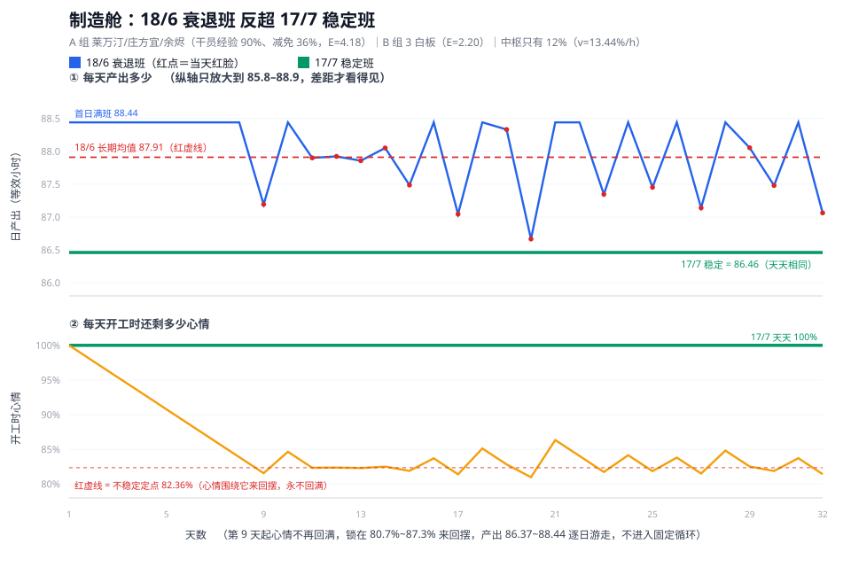

# 帝江号制造舱：18/6 衰退班反超 17/7 稳定班

> 全文只算一个情形：**不稳定方案（接受红脸衰减）长期反超稳定方案**。判据与公式见 `帝江号排班与产出计算逻辑.md` §4.4。



- **上图**：每天产出（等效小时）。绿线 = 17/7 稳定（天天 86.46）；蓝线 = 18/6，红点 = 当天红脸；红虚线 = 18/6 的长期均值 87.91 —— **它比绿线高**，这就是"衰退反而更好"。
- **下图**：每天**开工时**的心情。绿线天天 100%；橙线从第 9 天起回不到满值，在 80.7%~87.3% 之间来回摆。
- **上图**的纵轴刻意只放大到 85.8~88.9，否则 1 小时多的差距在图上看不见；**下图**的纵轴是 78%~101%。

## 1. 配置

| 项 | A 班 0–18 | B 班 18–24 |
|---|---|---|
| 名单 | 莱万汀、庄方宜、余烬 | 3 名白板 |
| 干员经验加成 / 减免 | 90% / 36% | 0% / 0% |
| 倍率 `E` | **4.18** | **2.20** |
| 心情消耗 `d` | **4.608%/h** | 7.2%/h |

- `速率 = (100 + 40×3) × 1.90 = 418` ⇒ `E = 4.18`；白板 `220 × 1.00` ⇒ `E = 2.20`。
- `d = 0.072 × (1 − 36%) = 4.608%/h`。
- **中枢全天保持 1 个 12% 档**：两名 12% 干员轮换、第三槽空着 ⇒ `v = 12% × (1 + 12%) = 13.44%/h`。
  （中枢单人连续在岗上限 `1/0.072 = 13.889 h`，所以"全天 12%"必须两人接力，不能一个人顶 24 h。）

> 中枢压到这么弱是刻意的取样：真实排班里中枢能给到 48%（`v = 17.76%/h`），四个舱都能稳定。这里为了测出"衰退反超"的边界，才把中枢压到只剩 12%。中枢没有心情减免，`d = 7.2%/h` 恒定，但只影响中枢自己。

## 2. 临界点

```text
W* = 衰减方案的长期平均日工作时长（不撞 100% 上限时）
   = 24 × v / (d + v) = 24 × 13.44 / (4.608 + 13.44) = 17.8723 h
（含义：每天干这么多小时，心情消耗恰好等于休息期恢复）
```

- `17 ≤ W*` ⇒ 17/7 **稳定**，天天 86.46。
- `18 > W*` ⇒ 18/6 **不稳定**，第 9 天开始红脸。

## 3. 18/6 的逐日轨迹

| 天 | 开工心情 | 实际工作 | 日产出 | 红脸 |
|---|---|---|---|---|
| 1 | 100.0% | 18.00 h | 88.44 | 否 |
| 2 | 97.7% | 18.00 h | 88.44 | 否 |
| 3 | 95.4% | 18.00 h | 88.44 | 否 |
| 4 | 93.1% | 18.00 h | 88.44 | 否 |
| 5 | 90.8% | 18.00 h | 88.44 | 否 |
| 6 | 88.5% | 18.00 h | 88.44 | 否 |
| 7 | 86.2% | 18.00 h | 88.44 | 否 |
| 8 | 83.9% | 18.00 h | 88.44 | 否 |
| 9 | 81.6% | 17.70 h | 87.19 | 是 |
| 10 | 84.7% | 18.00 h | 88.44 | 否 |
| 11 | 82.3% | 17.87 h | 87.90 | 是 |
| 12 | 82.4% | 17.88 h | 87.92 | 是 |
| 13 | 82.3% | 17.86 h | 87.86 | 是 |
| 14 | 82.5% | 17.91 h | 88.05 | 是 |
| 15 | 81.9% | 17.77 h | 87.49 | 是 |
| 16 | 83.7% | 18.00 h | 88.44 | 否 |

**长期统计**

| 指标 | 数值 | 来源 |
|---|---|---|
| 平均日产出 | **87.91** | 逐日模拟（第 401–1200 天取均值）；闭式 `4.18×17.8723+2.2×6 = 87.906` 吻合 |
| 日产出区间 | **86.35 ~ 88.44** | 闭式：`4.18×(80.64%/4.608%) + 13.2 = 86.35` 到 `4.18×18 + 13.2 = 88.44` |
| 开工心情区间 | **80.64% ~ 87.36%** | 闭式：`R` 到 `24v − (v/d)·R` |
| 红脸天数占比 | 约一半 | 该计数依赖浮点路径（换一种推进方式会得到 404 或 411 天），**不作为可复算指标** |

- 心情**永远不会回到 100%**：它围绕不稳定定点 `d × W* = 82.36%`（恰好够干 W* 小时的那点心情）来回摆。
- 也**不会进入固定循环**——第 9 天之后产出每天都不一样，所以只能用长期均值比较，不能用“首日”或“某一天”。
- 最低的那天落在区间下界 86.35（对应开工心情 80.64%），**比稳定方案的 86.46 还低 0.11**，但均值高 1.45。

## 4. 全部班长的长期收益

```text
刻度 58 → 100，每格 0.5，★ = 17/7 稳定班 86.46
14h  80.52 █████████████████████████████████████████████············★··························
15h   82.5 █████████████████████████████████████████████████········★··························
16h  84.48 █████████████████████████████████████████████████████····★··························
17h  86.46 █████████████████████████████████████████████████████████★··························
18h  87.91 █████████████████████████████████████████████████████████★██························
19h  84.62 █████████████████████████████████████████████████████····★··························
20h  78.54 █████████████████████████████████████████················★··························
21h  70.24 ████████████████████████·································★··························
22h  63.77 ████████████·············································★··························
23h  61.57 ███████··················································★··························
```

```text
刻度：等效小时/天，58 → 100，每格 0.5，★ = 17/7 稳定班 86.46
（每行按向下取整画格子，所以 22h 那一行是 11 格）
14h  80.52 █████████████████████████████████████████████············★··························
15h   82.5 █████████████████████████████████████████████████········★··························
16h  84.48 █████████████████████████████████████████████████████····★··························
17h  86.46 █████████████████████████████████████████████████████████★··························
18h  87.91 █████████████████████████████████████████████████████████★██························
19h  84.62 █████████████████████████████████████████████████████····★··························
20h  78.54 █████████████████████████████████████████················★··························
21h  70.24 ████████████████████████·································★··························
22h  63.77 ███████████·············································★··························
23h  61.57 ███████··················································★··························
```

| 班长 | 稳定？ | 首日产出 | 长期均值 | 与 17/7 比 |
|---|---|---|---|---|
| 14/10 | 稳定 | 80.52 | 80.52 | −5.94 |
| 15/9 | 稳定 | 82.50 | 82.50 | −3.96 |
| 16/8 | 稳定 | 84.48 | 84.48 | −1.98 |
| 17/7 | 稳定 | 86.46 | 86.46 | — |
| **18/6** | **衰退** | **88.44** | **87.91** | **+1.45** |
| 19/5 | 衰退 | 90.42 | 84.62 | −1.84 |
| 20/4 | 衰退 | 92.40 | 78.54 | −7.92 |
| 21/3 | 衰退 | 94.38 | 70.24 | −16.22 |
| 22/2 | 衰退 | **95.11** | 63.77 | −22.69 |
| 23/1 | 衰退 | **92.91** | 61.57 | −24.89 |

> **首日那一列在 22 h 之后就不再增长了**：`1/d = 21.7014 h`，班长超过它之后，首日的 `H` 被截断在 21.7014，多排的小时只砍 B 班。
> `22/2 = 4.18×21.7014 + 2.2×2 = 95.11`；`23/1 = 4.18×21.7014 + 2.2 = 92.91`。

**18/6 的长期均值（87.91）是这张表的最大值**，而它不满足稳定性判据——这正是本例的意义：`R < C` 不能直接当“不可行”丢掉。

## 5. 为什么这里衰退能赢

只差 1 小时班长，所以只需要比较 1 小时的得失：

```text
W* = 17.8723 h  →  小数部分 0.8723 h
A 班多榨出来：E_A × 0.8723 = 4.18 × 0.8723 = 3.646
B 班被砍 1 小时：E_B = 2.20
3.646 > 2.20  ⇒  18/6 反超
```

**判据（两班）**

```text
E_A × (W* − ⌊W*⌋) > E_B   ⇒   衰退的 (⌊W*⌋+1) 班优于稳定的 ⌊W*⌋ 班
```

成败只取决于两件事：`W*` 的小数部分够不够大、B 班够不够弱。本例两个条件都压到极端（0.872 小数 + 2.20 白板）。

> 反过来的情形：`W*` 的小数部分很小、B 班又强。**用另一套配置举例**（会客室：`d = 3.312%`、`v = 17.76%` ⇒ `W* = 20.228`，`E_A = 4.18`、`E_B = 2.86`）：`4.18 × 0.228 = 0.95 < 2.86` ⇒ 衰退必输，20/4 稳定班最优。

## 6. 为什么 19 h 以上断崖式下跌

`h ≥ 19` 时心情轨迹不再是"绕 82.36% 摆"，恢复量会冲到 100% 以上，**被上限截断浪费掉**：

| 班长 | 长期均值 | 1200 天里撞 100% 上限的次数 |
|---|---|---|
| 18/6 | 87.91 | 0 |
| 19/5 | 84.62 | 300 |
| 20/4 | 78.54 | 600 |
| 21/3 | 70.24 | 600 |

每次撞上限，多出来的恢复量全部作废，均值被压到闭式 `E_A·W* + E_B·(24−h)` 以下。

**本例中只有 `h = ⌊W*⌋ + 1` 这个不稳定班次恰好不撞上限**，闭式才与模拟一致（`4.18 × 17.8723 + 2.20 × 6 = 87.91`）。`h = ⌊W*⌋ = 17` 本身就是稳定班，闭式直接等于它的日产出（86.46）。所以：

```text
长期均值 = E_A × min(班长, W*) + E_B × (24 − 班长)      # 不撞 100% 上限时
```

`h` 再长就必须逐日模拟，没有闭式。

**为什么更长的 `h` 必然更差**（补上这一步证明）：

```text
① 闭式 E_A·min(h, W*) + E_B·(24−h) 在 h > W* 时对 h 单调递减（E_B > 0）
② 实际长期值 ≤ 闭式（撞上限只会把恢复量丢掉，不会凭空多出来）
⇒ h 越长，闭式越小、实际值只会更小 ⇒ 最优只可能落在 h ≤ ⌊W*⌋+1
```

## 7. 结论

1. **18/6 是这个配置下的最优班长，且它是衰退方案**：87.91 高于 17/7 的 86.46，也高于其余所有班长。
2. **求解器见到 `R < C` 不能直接丢分支**，要算长期值与稳定值比一次（§4.4）。
3. **但只需比 `h = ⌊W*⌋` 和 `⌊W*⌋+1` 两个**：更长的班长不仅要求更高的中枢，撞上限后长期值还单调下跌。
4. **这个反超只在"中枢极弱 + B 班极弱"时出现**。全船员可排时中枢能到 48%（`v = 17.76%/h`），四个舱全部满足 `h ≤ W*`，不会出现衰退班。
